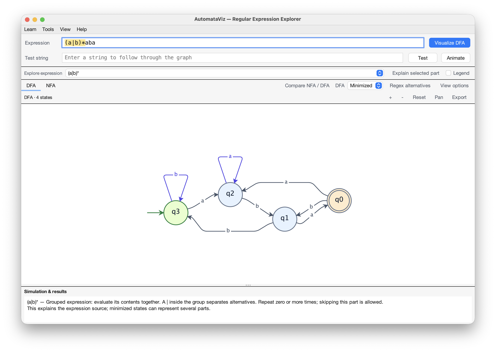

# AutomataViz

[](https://github.com/AdhamAfis/AutomataViz/actions/workflows/pages.yml)
[](pom.xml)
[](https://github.com/AdhamAfis/AutomataViz/releases)

A desktop learning tool for regular expressions and finite automata. Build a graph, follow an input through it, and explore how an expression becomes an NFA and a minimized DFA.



## Explore

- **Visualize expressions** as interactive NFA and DFA graphs, with side-by-side comparison.
- **Animate a test string** with pause, speed controls, backward/forward stepping, and explanations of acceptance or rejection.
- **Learn the conversion** through construction snapshots, ε-NFA simulation, subset discovery, and partition refinement.
- **Edit transitions** by reconnecting endpoints; the expression updates to match the edited graph.
- **Compare regex alternatives**: shortest found and easiest to read, each checked for exact language equivalence.
- Pan, zoom, export PNGs, and choose light or dark FlatLaf themes.

## Run

Requires **Java 11 or newer**. Download the bundled JAR from [Releases](https://github.com/AdhamAfis/AutomataViz/releases) and run it with `java -jar <downloaded-file>.jar`.

To build the current source, install Maven and run from the repository root:

```sh
mvn clean package
java -jar target/AutomataViz-1.2.0-jar-with-dependencies.jar
```

## Try an expression

Enter `(a|b)*abb`, click **Visualize DFA**, then test `aabb`. Choose **Animate** to follow each character and transition, or **Learn → Guided exercise: recognize a suffix** to predict results and check your reasoning. **Learn → Step-by-Step conversion** includes construction snapshots with Back/Next.

Supported syntax includes `|`, `*`, `+`, `?`, groups, character classes, and `.`. See the [user guide](docs/USAGE.md) for examples, editing controls, and syntax limitations. Generated alternatives preserve the language; “shortest found” does not guarantee the globally shortest regex.

## Documentation

- [Release notes](CHANGELOG.md)
- [User guide](docs/USAGE.md)
- [Build and interaction checks](docs/TESTING.md)
- [Contributing](CONTRIBUTING.md) · [Security reports](SECURITY.md)
- [Project website and local preview](website/README.md)
- [Repository and GitHub Pages setup](.github/REPOSITORY_SETUP.md)
- [MIT License](LICENSE)
